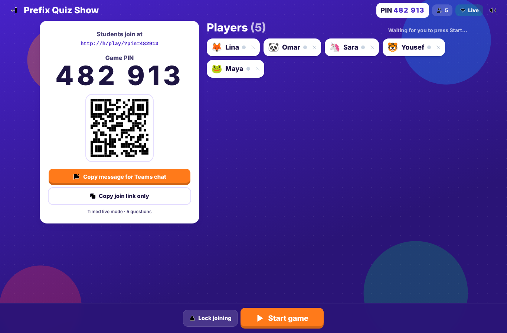
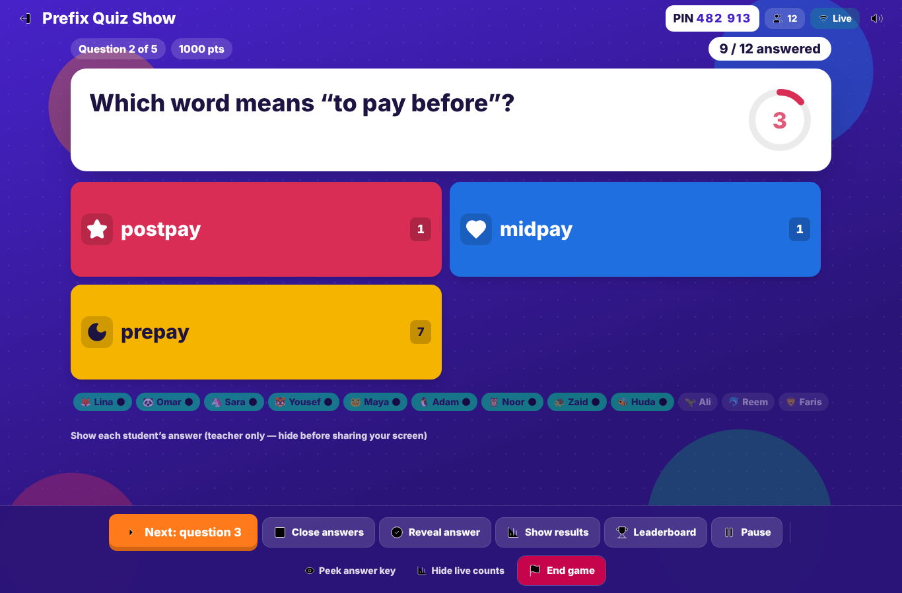
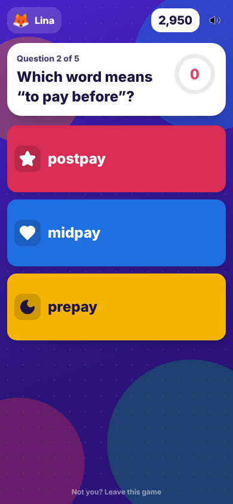
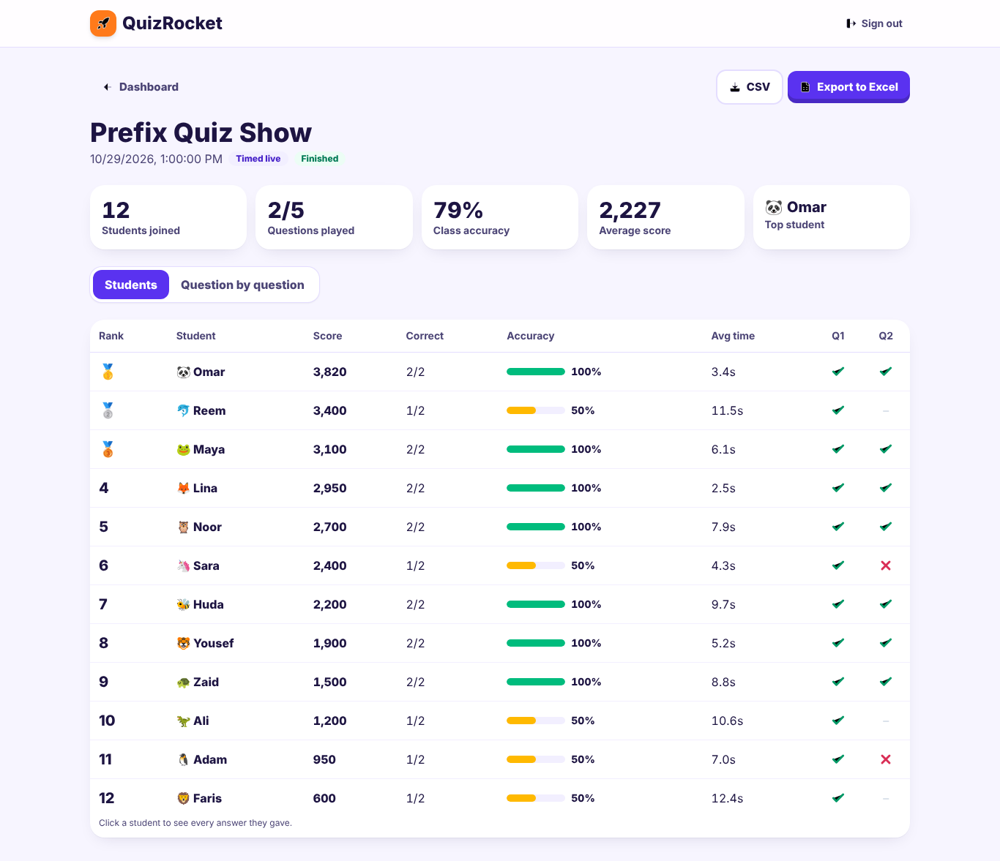

# 🚀 QuizRocket — live classroom quizzes for Microsoft Teams lessons

QuizRocket is a real-time, teacher-controlled quiz game. You build a quiz, click **Host live game**, paste the join
link into your Teams chat, and students play on their own phones, tablets or computers — no accounts, no app installs.
**You** decide when the game starts, when each question appears, when answers close, when the correct answer is
revealed, when the leaderboard shows, and when the game ends.



| Teacher control panel | Student phone | Results & export |
|---|---|---|
|  |  |  |

---

## Contents
1. [How it works](#1-how-it-works)
2. [Project structure](#2-project-structure)
3. [One-time setup (≈15 minutes)](#3-one-time-setup-15-minutes)
4. [Run it on your computer](#4-run-it-on-your-computer)
5. [Put it online (HTTPS link)](#5-put-it-online-https-link)
6. [Using it in a Teams lesson](#6-using-it-in-a-teams-lesson)
7. [Teacher controls, modes and scoring](#7-teacher-controls-modes-and-scoring)
8. [Security model](#8-security-model)
9. [Testing](#9-testing)
10. [Deeper Microsoft Teams integration (later)](#10-deeper-microsoft-teams-integration-later)
11. [Troubleshooting](#11-troubleshooting)

---

## 1. How it works

```
 Teacher browser (dashboard + host)          Student browsers (phone / tablet / PC)
        │  email + password login                    │  invisible anonymous login
        │                                            │
        ▼                                            ▼
 ┌──────────────────────── Supabase (hosted) ────────────────────────┐
 │  Postgres database      quizzes · questions · game_sessions ·      │
 │                         session_questions · participants · answers │
 │  Game engine (SQL)      host_game · join_game · host_control ·     │
 │                         submit_answer · get_my_status · restart    │
 │  Row Level Security     students can't read answer keys, other     │
 │                         students' rows, or change any score        │
 │  Realtime               pushes every change to every screen        │
 │  Storage                question / answer images                   │
 └────────────────────────────────────────────────────────────────────┘
        ▲
        │ static site (HTML/JS) served over HTTPS by Vercel / Netlify / any static host
```

* **Frontend:** Next.js 15 + React 19 + TypeScript + Tailwind CSS 4, exported as a static site (no server to run).
* **Backend:** Supabase — Postgres, Auth, Realtime and Storage. All game rules run *inside the database* as
  `SECURITY DEFINER` functions, so scoring, timing and permissions can't be faked from a browser.
* **Real-time:** Supabase Realtime streams row changes. Every teacher click produces exactly one versioned state
  change, so all screens move together. If a student's Wi-Fi drops, the app reconnects and reloads the current state;
  refreshing the page puts them straight back into the game with the same name and score.

## 2. Project structure

```
quizrocket/
├── README.md                     ← this guide
├── .env.example                  ← copy to .env.local and fill in 2 values
├── package.json  next.config.mjs  tsconfig.json  postcss.config.mjs
├── supabase/
│   ├── schema.sql                ← run once in Supabase (tables, security, game engine, realtime, storage)
│   └── tests/
│       ├── 00_supabase_stubs.sql     (local testing only)
│       ├── 01_game_flow_test.sql     71 automated checks: full game + cheating attempts
│       └── 02_concurrency_test.sh    30 students answering at the same instant
├── samples/
│   └── prefix-quiz-show.csv      ← 10-question quiz from your Prefix 5E lesson, ready to import
├── docs/screenshots/             ← every screen
├── public/favicon.svg
└── src/
    ├── app/
    │   ├── page.tsx              Home: "Join a game" (PIN entry)           → /
    │   ├── login/page.tsx        1. Teacher login / sign-up / reset        → /login/
    │   ├── dashboard/page.tsx    2. Teacher dashboard + game reports       → /dashboard/
    │   ├── quiz/edit/page.tsx    3. Create / edit quiz, images, CSV/Excel  → /quiz/edit/?id=…
    │   ├── quiz/preview/page.tsx 4. Quiz preview                           → /quiz/preview/?id=…
    │   ├── host/page.tsx         5, 9, 10, 11. Lobby, live control, results, leaderboard, podium → /host/?session=…
    │   ├── play/page.tsx         6, 7, 8. Student join, lobby, question, feedback, leaderboard, final → /play/?pin=…
    │   └── results/page.tsx      12. Final results & analytics, CSV/Excel export → /results/?session=…
    ├── components/               UI kit, answer tiles, timer, leaderboard, podium, image upload, host dialog
    └── lib/                      Supabase clients, realtime/reconnect hook, types, analytics, import/export, sounds
```

## 3. One-time setup (≈15 minutes)

You need two free accounts: **Supabase** (database) and **Vercel** (or Netlify) for hosting.
Nothing here needs a credit card on the free tiers.

### 3.1 Create the Supabase project
1. Go to <https://supabase.com>, sign up, click **New project**. Pick a region close to your school
   (e.g. *Middle East* or *Central EU*), set a database password (keep it safe), wait ~2 minutes.
2. Open **SQL Editor → New query**, paste the whole of [`supabase/schema.sql`](supabase/schema.sql), click **Run**.
   You should see "Success. No rows returned". (It's safe to run again after updates.)
3. **Turn on student joining:** **Authentication → Sign In / Providers** → enable **"Allow anonymous sign-ins"** → Save.
   *(Students get an invisible guest identity; without this, students can't join.)*
4. **Email sign-in for teachers** is on by default. For convenience you can turn off
   **"Confirm email"** (Authentication → Sign In / Providers → Email) while you set up, or leave it on and click the
   link Supabase emails you.
5. Get your keys: **Project Settings → API Keys** (or *Data API*). Copy:
   * **Project URL** — looks like `https://abcd1234.supabase.co`
   * **anon / publishable key** — the *public* key. ⚠️ Never use the `service_role` / secret key in this app.

### 3.2 Configure the app
```bash
cp .env.example .env.local
# edit .env.local:
NEXT_PUBLIC_SUPABASE_URL=https://abcd1234.supabase.co
NEXT_PUBLIC_SUPABASE_ANON_KEY=eyJ...   (or sb_publishable_...)
```
Both values are public by design — security is enforced by the database rules, not by hiding these.

## 4. Run it on your computer
Requires **Node.js 18.18+** (20 or 22 recommended — <https://nodejs.org>).
```bash
npm install
npm run dev          # open http://localhost:3000
```
Create your teacher account at <http://localhost:3000/login/>.
To test with students on *other* devices you need the online HTTPS version (next section) — `localhost` only works on
your own machine.

## 5. Put it online (HTTPS link)

### Option A — Vercel (recommended)
1. Put this folder in a GitHub repository (GitHub Desktop → *Add local repository* → *Publish*).
2. Go to <https://vercel.com> → **Add New → Project** → import the repository. Framework: **Next.js** (auto-detected).
3. Under **Environment Variables** add `NEXT_PUBLIC_SUPABASE_URL` and `NEXT_PUBLIC_SUPABASE_ANON_KEY`. Click **Deploy**.
4. You get a permanent HTTPS address like `https://quizrocket-yourname.vercel.app`.
   (Optional: Settings → Domains to use your own domain.)

### Option B — Netlify (drag & drop, no GitHub)
```bash
npm run build        # creates the static site in ./out
```
Go to <https://app.netlify.com/drop> and drag the **`out`** folder in. Netlify gives you an HTTPS link.
(Re-run `npm run build` and drag again after changes. Env vars must be in `.env.local` *before* building.)

### 5.1 Tell Supabase your web address (needed for email links)
Supabase → **Authentication → URL Configuration**:
* **Site URL:** `https://quizrocket-yourname.vercel.app`
* **Redirect URLs:** add `https://quizrocket-yourname.vercel.app/**` (and `http://localhost:3000/**` for local testing)

### 5.2 Your permanent, shareable links
| Link | What it does |
|---|---|
| `https://YOUR-SITE/play/` | **Permanent student link.** Students open it and type the PIN you show. Pin it in your Teams class once and reuse it forever. |
| `https://YOUR-SITE/play/?pin=482913` | One-click link for **one** game (the PIN is pre-filled). The host screen copies this for you. |
| `https://YOUR-SITE/dashboard/` | Your teacher dashboard (bookmark it). |

Each hosted game gets a fresh 6-digit PIN. Quizzes are saved permanently and can be hosted again any time.

## 6. Using it in a Teams lesson
1. Open `https://YOUR-SITE/dashboard/` on your teacher computer and sign in.
2. On a quiz card click **Host live game** → choose **Teacher-paced** or **Timed live** → **Create game lobby**.
3. Click **Copy message for Teams chat** and paste it in the meeting/class chat. It contains the link and PIN.
   (Share your screen too if you like: the lobby shows the PIN and a QR code for tablets.)
4. Watch names appear live. Remove (✕) any inappropriate nickname — the student is asked to pick a new one — or block them.
5. Press **Start game** when everyone is in. Nothing happens on students' screens until you do.
6. Press **Show question 1**. Every student sees the same question at the same moment.
7. Watch "**9 / 12 answered**" and the live counts. Close answers, **Reveal answer**, **Show results**,
   **Leaderboard**, then **Next question** — each only when *you* click it.
8. **End game** shows the podium on everyone's screen. Click **Full results & export** for the report,
   or **Play again** for a new round (students get a "Join the next game" button automatically).

> **Screen-sharing tip:** the host screen never shows the correct answer before you reveal it. "Peek answer key"
> and "Show each student's answer" are for your eyes — hide them before sharing your screen.

## 7. Teacher controls, modes and scoring

| Control | Shortcut | What happens |
|---|---|---|
| Start game | S | Lobby → "Get ready" screen. The game never starts on its own. |
| Next / Show question N | N | Releases the next question to every device (scores the current one if you skip Reveal). |
| Close answers | C | Stops accepting answers immediately (server-enforced). |
| Reveal answer | R | Shows the correct answer; students see Correct / Not this time and their points. |
| Show results | V | Class bar chart, % correct, average time — on your screen and students'. |
| Leaderboard | L | Rankings on all screens (students see top 5 + their own rank). |
| Pause / Resume | P | Freezes the timer and blocks answers; students see a "Paused" screen. |
| Peek answer key | K | Shows the key on *your* screen only. |
| End game | — | Final podium for everyone; report saved. |
| Play again | — | New lobby with the same quiz and a new PIN. |
| Lock joining | — | Stops new students joining (rejoining after a refresh still works). |

**Teacher-paced mode:** no countdown; answers stay open until you click Close/Reveal; correct = full points.
**Timed live mode:** countdown per question; answers close automatically at 0 or when everyone has answered;
correct answers earn between 100% (instant) and 50% (at the buzzer) of the question's points. Points per question:
0 (practice), 500, 1000 or 2000. Wrong or no answer = 0. Streaks (🔥) are shown for 3+ correct in a row.

**Results & analytics** (Dashboard → *Game reports*, or after a game): students joined, answered per question,
correct/incorrect, class accuracy, % choosing each answer, answer times, rankings, a question-by-question report
(flags questions under 50% as "worth re-teaching"), and a per-student drill-down. **Export to Excel** gives four
sheets (Students, Questions, All answers, Summary); **CSV** gives the student table.

**Importing questions:** Editor → *Import from CSV / Excel*. Download the template there, or import
[`samples/prefix-quiz-show.csv`](samples/prefix-quiz-show.csv) — 10 questions built from your *Prefix 5E* lesson
(fore–, mid–, pre–, post–, real vs. fake prefixes, finish-the-sentence).

## 8. Security model
* **No secrets in the browser.** The app only uses the public anon key; there is no service-role key anywhere.
* **Row Level Security on every table.** Teachers see only their own quizzes, games and results. Students can read
  only the public game state of a game they joined and their own player row.
* **Answer keys never leave the server early.** Live questions are sent to students without `is_correct`; the
  correct answer is published only when the teacher reveals it.
* **Server-side game engine.** Only the session's host can start/advance/reveal/end. Answers are validated on the
  server (right game, live question, not paused, before the deadline + 1.5 s network grace, valid option, one answer
  per student per question — enforced by a unique constraint). Points are computed by the server from server time
  and added to totals exactly once per question.
* **Students cannot** start games, advance questions, reveal answers, see other students' answers, change answers
  after submitting, change scores, or touch another class's game — each of these is covered by the automated tests.
* Image uploads: teachers only, into their own folder, images ≤ 5 MB.

## 9. Testing

### 9.1 Automated tests of the game engine (optional, for developers)
On any PostgreSQL 15/16 (not your Supabase project):
```bash
createdb qr_test
psql -d qr_test -f supabase/tests/00_supabase_stubs.sql
psql -d qr_test -f supabase/schema.sql
psql -d qr_test -f supabase/tests/01_game_flow_test.sql      # 71 checks → "ALL GAME ENGINE TESTS PASSED"
PSQL="psql -d qr_test" ./supabase/tests/02_concurrency_test.sh   # → "CONCURRENCY TEST PASSED"
```

### 9.2 Classroom acceptance checklist (use real separate devices)
Use your computer as teacher and at least three other devices (phones/tablets, or one in a private/incognito window
of a *different* browser). Two tabs of the *same* browser count as the same student by design.

- [ ] **Teacher:** sign up / sign in at `/login/` on the computer.
- [ ] Create a quiz with **5 questions** (or import `samples/prefix-quiz-show.csv` and delete 5), include one True/False and one image. Save.
- [ ] Preview it; answers show correct/incorrect.
- [ ] **Host live game** → lobby shows a 6-digit PIN, join link and QR code.
- [ ] **Copy message for Teams chat** and paste it into a Teams chat.
- [ ] **3 students** open the link from Teams on their own devices and enter names → all 3 appear in the lobby within ~1 s.
- [ ] Try a duplicate name → refused. Remove one student → their screen asks for a new name; they rejoin.
- [ ] Students' screens stay on "Waiting for your teacher" — nothing starts until you press **Start**.
- [ ] **Show question 1** → all three see the same question at the same time.
- [ ] Students answer → each sees "Answer locked in"; your screen counts 1/3, 2/3, 3/3 and shows who answered.
- [ ] Turn one student's Wi-Fi off and on (or refresh the page) → they return to the same game, same answer state.
- [ ] Try tapping a second answer → not possible. Teacher **Close answers**, then a late tap is rejected.
- [ ] **Reveal answer** only when you choose → students see Correct/Not this time and points.
- [ ] **Show results** → correct % and answer distribution match what students chose.
- [ ] **Next question** only when you choose; test **Pause/Resume** (timer freezes, answers blocked).
- [ ] **Leaderboard** → highest scorer is first; each student sees their own rank.
- [ ] **End game** → podium on all screens; **Full results** shows each student's real answers; **Export to Excel** opens.
- [ ] **Play again** → students tap "Join the next game".
- [ ] Sign in as a *different* teacher → you cannot see the first teacher's quizzes or reports.

## 10. Deeper Microsoft Teams integration (later)
The normal browser link already covers everything above. If you later want QuizRocket *inside* Teams:
1. **Website tab (no code):** in a Team channel click **+ → Website** and paste `https://YOUR-SITE/play/`.
   Students open the tab, type the PIN, and play without leaving Teams.
2. **Teams app (Developer Portal / Teams Toolkit):** wrap the same URLs in a Teams app manifest with a
   *meeting side panel* (teacher host controls) and *meeting stage* (shared question view), using the
   Teams JavaScript SDK (`@microsoft/teams-js`). Add your domain to `validDomains`. Your school's Teams admin must
   allow custom app upload. No changes to the database are needed.
3. **Single sign-on (optional):** add Microsoft (Azure AD / Entra ID) as a Supabase auth provider so teachers sign in
   with their school account.

## 11. Troubleshooting
| Problem | Fix |
|---|---|
| "Almost ready!" screen | `.env.local` (or Vercel env vars) missing — add both values and rebuild/redeploy. |
| Students see "Student joining is not switched on yet" | Enable **Allow anonymous sign-ins** (step 3.1-3). |
| Teacher sign-up: "check your inbox" | Click the email link, or turn off *Confirm email* in Supabase. Set the Site URL (5.1). |
| Students don't see updates live | Re-run `schema.sql` (it adds the tables to Realtime). The app also re-syncs every few seconds when the live link drops. |
| "Could not find the function …" | `schema.sql` wasn't run (or failed) — run it again in the SQL Editor. |
| Images won't upload | Re-run `schema.sql` (creates the `quiz-media` bucket and its policies). |
| Game didn't load after a week off | Free Supabase projects pause after a period of inactivity — open the Supabase dashboard and click **Restore**. |
| Class bigger than ~100 at once | Check Supabase's plan limits for concurrent Realtime connections. |

---
Built with Next.js, Supabase, Tailwind CSS, lucide icons, SheetJS (spreadsheet import/export), qrcode.react and canvas-confetti.
